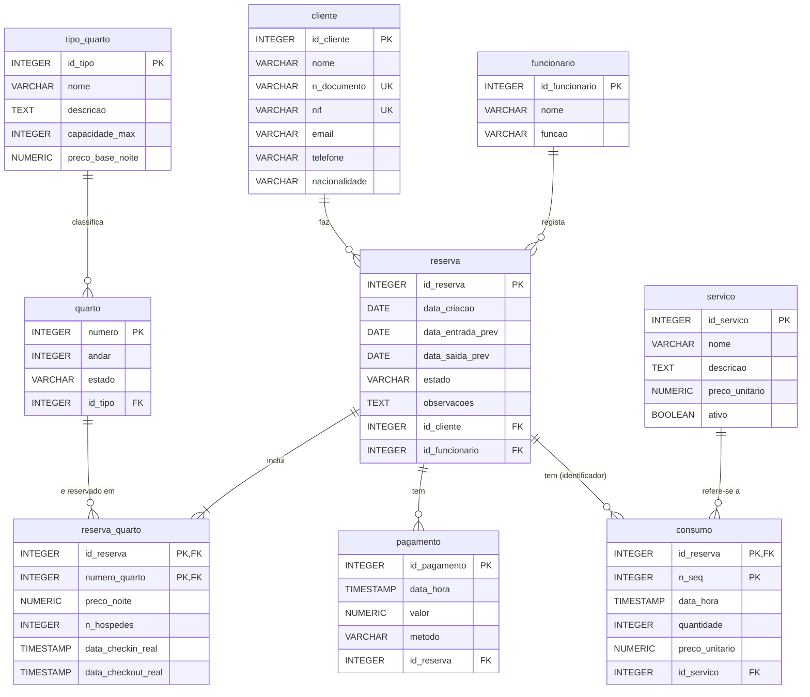

# BDAD 2026/27 — Base de dados de Alojamento Local

Projeto prático da UC de **Bases de Dados (BDAD)**, Engenharia Informática, UFP, 3º ano, 1º semestre. Docente: José Torres.

## Contexto escolhido

**Contexto A — Alojamento local / Hotel.**

## Grupo

| Nome | GitHub |
|---|---|
| Diogo Vicente | [DiogoVicente8](https://github.com/DiogoVicente8) |
| João Reis | [@joaoreis2121](https://github.com/joaoreis2121) |

## Objetivo e âmbito

Desenvolver uma base de dados relacional em PostgreSQL para uma pequena unidade de alojamento local, que permita gerir quartos, clientes, reservas, ocupação, serviços e pagamentos, e responder a perguntas como "que quartos estão livres entre duas datas?" ou "qual o saldo de cada reserva?".

O âmbito detalhado (o que está dentro e fora, pressupostos e glossário) está em [`docs/fase1.md`](docs/fase1.md).

## Organização do trabalho

O projeto desenvolve-se em três fases incrementais, todas neste repositório. Cada entrega corresponde a uma release/tag Git.

| Fase | Trabalho principal | Tag | Estado |
|---|---|---|---|
| 1 | Análise e modelação conceptual | `v1.0` | documentação e modelo conceptual concluídos; tag existente `v1.0-e1` |
| 2 | Projeto lógico e implementação | `v2.0` | requisitos 6.1–6.5 cumpridos; revisão final e tag de entrega pendentes |
| 3 | Exploração, controlo de acesso e testes | `v3.0` | por fazer |

## Modelo conceptual

O modelo conceptual (Fase 1) está representado em **notação de Chen** em [`modelos/modelo_conceptual.drawio`](modelos/modelo_conceptual.drawio) (editável) e [`modelos/modelo_conceptual.png`](modelos/modelo_conceptual.png). Abaixo está uma versão equivalente em Mermaid (notação pé de galinha), para consulta rápida diretamente no GitHub.



Notas: no Mermaid o relacionamento `INCLUI` aparece como entidade associativa (não suporta atributos em relacionamentos), `CONSUMO` é uma entidade fraca de `RESERVA` (linha contínua) e `total` é um atributo derivado. Os tipos indicados são domínios conceptuais, não tipos SQL. Detalhes em [`modelos/modelo_conceptual_mermaid.md`](modelos/modelo_conceptual_mermaid.md) e [`docs/fase1.md`](docs/fase1.md).

## Estrutura do repositório

```text
.
├── README.md
├── docs/
│   ├── fase1.md
│   └── fase2.md                     # mapeamento, normalização, regras e validação
├── modelos/
│   ├── modelo_conceptual.drawio     # modelo principal de Chen (draw.io)
│   ├── modelo_conceptual.png
│   ├── modelo_conceptual_mermaid.md
│   └── modelo_relacional.md         # nove tabelas e catálogo dos domínios
├── sql/
│   ├── drop.sql
│   ├── Table.sql                    # núcleo (Diogo)
│   ├── servicos_pagamentos.sql      # vendas (João)
│   ├── vistas.sql
│   ├── run_all.sql                  # recriação e povoamento numa transação
│   ├── consultas_q01_q07.sql
│   └── consultas_q08_q14.sql
├── dados/
│   ├── povoamento_nucleo.sql
│   └── povoamento_servicos.sql
└── testes/                         # reservado para a Fase 3
```

## Documentação por fase

- **Fase 1 (v1.0):** [`docs/fase1.md`](docs/fase1.md)
  - Análise e âmbito, glossário
  - Requisitos de dados (RD01–RD14)
  - Regras de negócio (RN01–RN16)
  - Atores e necessidades de acesso
  - Necessidades de informação (Q01–Q14)
  - Modelo conceptual ER (notação de Chen)
  - Rastreabilidade

- **Fase 2:** [`docs/fase2.md`](docs/fase2.md), com a auditoria dos requisitos 6.1–6.5 e as limitações previstas para a Fase 3.
- **Modelo relacional:** [`modelos/modelo_relacional.md`](modelos/modelo_relacional.md).

A entrega da Fase 2 corresponde às secções 6.1–6.5 do enunciado: modelo
relacional, normalização, implementação, povoamento e início das consultas.
Não é obrigatório concluir Q01–Q14 nesta fase; as consultas já existentes
foram preservadas. Os testes formais ficam para a Fase 3.

## Como reproduzir a base de dados e executar as consultas

Instalar **PostgreSQL 18** com o servidor e as ferramentas de linha de comandos
`psql` e `createdb` (validação efetuada em 18.6). Iniciar o servidor e disponibilizar
a pasta `bin` no `PATH`, ou usar o caminho completo dos executáveis. No Windows,
é normalmente `C:\Program Files\PostgreSQL\18\bin`. O pgAdmin é opcional;
os scripts com comandos `\ir` e `\set` devem ser executados em `psql`,
não diretamente no Query Tool do pgAdmin.

Executar os comandos seguintes **na raiz do repositório**. Usar um utilizador
com permissões para criar a base e os objetos. Adaptar `-U postgres` à instalação;
se necessário, acrescentar `-h localhost -p 5432`. A palavra-passe é solicitada
pelo cliente, não fica guardada nos scripts.

A base de dados **`Alojamento` deve existir antes da execução**. Criá-la uma
única vez, se ainda não existir:

```powershell
& "C:\Program Files\PostgreSQL\18\bin\createdb.exe" -U postgres -E UTF8 Alojamento
```

Recriar as tabelas do projeto e carregar todos os dados:

```powershell
& "C:\Program Files\PostgreSQL\18\bin\psql.exe" -X -v ON_ERROR_STOP=1 -U postgres -d Alojamento -f sql/run_all.sql
```

`run_all.sql` executa, por esta ordem, numa transação com `ON_ERROR_STOP`:

1. `sql/drop.sql` — remove as tabelas anteriores, a vista dependente e as identidades.
2. `sql/Table.sql` — cria as seis tabelas do núcleo.
3. `sql/servicos_pagamentos.sql` — cria as três tabelas de vendas.
4. `sql/vistas.sql` — cria `v_reserva_total`.
5. `dados/povoamento_nucleo.sql` — tipos, quartos, clientes, funcionários e reservas.
6. `dados/povoamento_servicos.sql` — serviços, consumos e pagamentos.

Pode repetir-se o comando de recriação: os IDs voltam ao início e os dados
ficam iguais. Se ocorrer um erro, a transação não é confirmada. Não repetir
isoladamente os INSERT de povoamento sobre dados já carregados.

Executar as consultas:

```powershell
& "C:\Program Files\PostgreSQL\18\bin\psql.exe" -X -v ON_ERROR_STOP=1 -U postgres -d Alojamento -f sql/consultas_q08_q14.sql
```

Para executar também as consultas Q01–Q07 já existentes:

```powershell
& "C:\Program Files\PostgreSQL\18\bin\psql.exe" -X -v ON_ERROR_STOP=1 -U postgres -d Alojamento -f sql/consultas_q01_q07.sql
```

Q01–Q03 têm parâmetros de exemplo nas CTE `parametros`. Q06 usa noites reais,
o inventário total e a referência fixa `2026-11-14`; alterar a referência e o
intervalo (início no primeiro dia do mês) para outra análise. Q07 considera
estadias concluídas por quarto. Q11 depende de `CURRENT_DATE`. Q13 mede
cancelamentos pelo mês de criação da reserva, pois não se guarda a data do
cancelamento. Estas interpretações estão detalhadas na documentação da Fase 2.

**Validação anterior realizada em 14/11/2026 numa instância isolada:** PostgreSQL 18.6, recriação completa duas
vezes e Q01–Q14 executadas, com totais e saldos conferidos. Os dados são fictícios e representam uma fotografia de
14/11/2026: 4 tipos, 15 quartos, 9 clientes, 4 funcionários, 10 reservas,
11 associações reserva/quarto, 7 serviços, 13 consumos e 8 pagamentos: **81
registos nas nove tabelas**. O utilizador confirmou também a criação, o
povoamento, a vista, Q08–Q14 e os totais/saldos das dez reservas na base local
`Alojamento`. Nesta revisão documental não foram executados scripts SQL.

As regras que exigem validação entre tabelas ou de transições estão explicitamente
identificadas em `docs/fase2.md`. Não foram implementados triggers, roles,
controlo de acesso nem experiências de concorrência ou desempenho. A revisão
pelo grupo e a criação da tag `v2.0` são passos manuais ainda pendentes.

## Ferramentas

- diagrams.net/draw.io: modelo conceptual principal em notação de Chen
- Mermaid: diagramas auxiliares para consulta no GitHub
- Markdown: documentação
- PostgreSQL, `psql` e pgAdmin: implementação e testes
- Git e GitHub: versionamento e entregas
