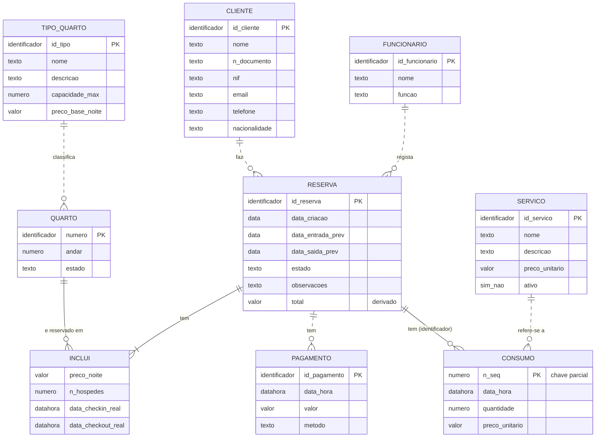

# BDAD 2026/27 — Base de dados de Alojamento Local

Projeto prático da UC de **Bases de Dados (BDAD)**, Engenharia Informática, UFP, 3º ano, 1º semestre. Docente: José Torres.

## Contexto escolhido

**Contexto A — Alojamento local / Hotel.**

## Grupo

| Nome | GitHub |
|---|---|
| Diogo Vicente | [DiogoVicente8](https://github.com/DiogoVicente8) |
| João Reis | [@joaoreis2121](https://github.com/joaoreis2121) |

## Objetivo e âmbito

Desenvolver uma base de dados relacional em PostgreSQL para uma pequena unidade de alojamento local, que permita gerir quartos, clientes, reservas, ocupação, serviços e pagamentos, e responder a perguntas como "que quartos estão livres entre duas datas?" ou "qual o saldo de cada reserva?".

O âmbito detalhado (o que está dentro e fora, pressupostos e glossário) está em [`docs/fase1.md`](docs/fase1.md).

## Organização do trabalho

O projeto desenvolve-se em três fases incrementais, todas neste repositório. Cada entrega corresponde a uma release/tag Git.

| Fase | Trabalho principal | Tag | Estado |
|---|---|---|---|
| 1 | Análise e modelação conceptual | `v1.0` | em entrega (semana 5) |
| 2 | Projeto lógico e implementação | `v2.0` | por fazer |
| 3 | Exploração, controlo de acesso e testes | `v3.0` | por fazer |

## Modelo conceptual

O modelo conceptual (Fase 1) está representado em **notação de Chen** em [`modelos/modelo_conceptual.drawio`](modelos/modelo_conceptual.drawio) (editável) e [`modelos/modelo_conceptual.png`](modelos/modelo_conceptual.png). Abaixo está uma versão equivalente em Mermaid (notação pé de galinha), para consulta rápida diretamente no GitHub.



Notas: no Mermaid o relacionamento `INCLUI` aparece como entidade associativa (não suporta atributos em relacionamentos), `CONSUMO` é uma entidade fraca de `RESERVA` (linha contínua) e `total` é um atributo derivado. Os tipos indicados são domínios conceptuais, não tipos SQL. Detalhes em [`modelos/modelo_conceptual_mermaid.md`](modelos/modelo_conceptual_mermaid.md) e [`docs/fase1.md`](docs/fase1.md).

## Estrutura do repositório

```
.
├── README.md
├── docs/
│   └── fase1.md                  # análise, requisitos, regras, atores, necessidades, modelo ER
├── modelos/
│   ├── modelo_conceptual.drawio  # ficheiro editável (diagrams.net / draw.io)
│   ├── modelo_conceptual.png     # representação visual
│   └── modelo_conceptual_mermaid.md  # versão em Mermaid (pé de galinha)
├── sql/                          # scripts SQL (Fase 2 em diante)
├── dados/                        # dados de povoamento (Fase 2 em diante)
└── testes/                       # testes de integridade, acesso, transações, concorrência
```

## Documentação por fase

- **Fase 1 (v1.0):** [`docs/fase1.md`](docs/fase1.md)
  - Análise e âmbito, glossário
  - Requisitos de dados (RD01–RD14)
  - Regras de negócio (RN01–RN16)
  - Atores e necessidades de acesso
  - Necessidades de informação (Q01–Q14)
  - Modelo conceptual ER (notação de Chen)
  - Rastreabilidade

## Como reproduzir a base de dados e os testes

_Será preenchido a partir da Fase 2, com a ordem de execução dos scripts em `sql/` e dos testes em `testes/`._

## Ferramentas

- mermaid: modelo conceptual
- Markdown: documentação
- PostgreSQL, `psql` e pgAdmin: implementação e testes
- Git e GitHub: versionamento e entregas