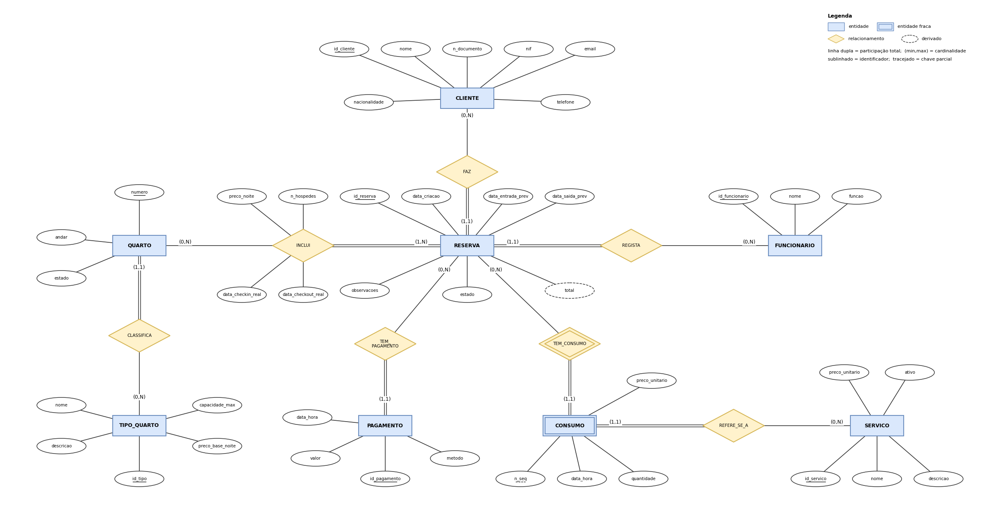

# Fase 1 — Análise e modelação conceptual (v1.0)

Contexto escolhido: **A — Alojamento local / Hotel**.

> Nesta fase não há implementação nem decisões específicas de PostgreSQL. Tudo o que está aqui é ao nível do problema real e do modelo conceptual.

**Índice**

1. [Análise e âmbito](#1-análise-e-âmbito)
2. [Glossário](#2-glossário)
3. [Requisitos de dados](#3-requisitos-de-dados)
4. [Regras de negócio](#4-regras-de-negócio)
5. [Atores e necessidades de acesso](#5-atores-e-necessidades-de-acesso)
6. [Necessidades de informação](#6-necessidades-de-informação)
7. [Modelo conceptual ER](#7-modelo-conceptual-er)
8. [Rastreabilidade (v1.0)](#8-rastreabilidade-v10)

---

## 1. Análise e âmbito

### 1.1 Problema

Uma pequena unidade de alojamento local (cerca de 15 a 30 quartos, sem restaurante próprio) gere hoje as reservas, os clientes e os pagamentos de forma dispersa. Pretende-se uma base de dados que centralize essa informação e permita saber, a qualquer momento, **que quartos estão livres, quem os ocupa, quanto é devido e quanto já foi pago**.

### 1.2 Objetivo

Representar de forma consistente: quartos e respetivos tipos, clientes, reservas (com um ou mais quartos e um período), a ocupação real (check-in/check-out), os serviços consumidos durante a estadia e os pagamentos.

### 1.3 Dentro do âmbito

- Quartos, tipos de quarto e respetivo preço base por noite.
- Clientes (quem faz e paga a reserva).
- Reservas, com um ou mais quartos e um único período (entrada/saída) por reserva.
- Ocupação real: registo de check-in e check-out por quarto.
- Serviços extra (pequeno-almoço, lavandaria, transfer, spa…) e o seu consumo por reserva.
- Pagamentos de uma reserva (sinal, pagamentos parciais, pagamento final).
- Funcionários que registam reservas.

### 1.4 Fora do âmbito (decisões justificadas)

| Fora do âmbito | Justificação |
|---|---|
| Contabilidade, faturação e IVA | O foco é a informação operacional; a faturação é outro sistema. |
| Registo individual de cada hóspede acompanhante | Basta guardar o **número** de hóspedes por quarto; mantém o modelo simples. |
| Tarifas sazonais e promoções | O preço da noite fica fixado por reserva e quarto, o que cobre variações sem uma entidade de tarifário. |
| Reembolsos e devoluções de sinal | Simplifica a regra de pagamentos; pode ser extensão futura. |
| Limpeza, manutenção detalhada, inventário, RH | Não são necessários para responder às necessidades de informação da secção 6. |
| Reservas por canais externos (Booking, etc.) | Assume-se que um funcionário regista todas as reservas. |

### 1.5 Pressupostos

- Todos os quartos de uma reserva partilham o mesmo período de entrada e saída. Se um cliente quiser períodos diferentes, são duas reservas.
- O cliente que faz a reserva é o responsável pelos pagamentos.
- O preço de um quarto numa reserva fica fixo no momento da reserva.
- Os serviços são cobrados à reserva (não a um quarto concreto).

---

## 2. Glossário

| Termo | Significado neste projeto |
|---|---|
| **Quarto** | Unidade física alugável, identificada por um número. |
| **Tipo de quarto** | Categoria de quartos (ex.: individual, duplo, suite) com capacidade máxima e preço base por noite. |
| **Cliente** | Pessoa que faz a reserva e é responsável pelos pagamentos. |
| **Funcionário** | Pessoa do alojamento que regista reservas e opera o sistema. |
| **Reserva** | Pedido de alojamento de um cliente, para um ou mais quartos, num período de entrada a saída. |
| **Período da reserva** | Intervalo da data de entrada prevista (inclusive) até à data de saída prevista (exclusive). |
| **Noite** | Cada dia do período, da entrada até ao dia anterior à saída. |
| **Estado da reserva** | Fase da reserva: *confirmada*, *em curso*, *concluída* ou *cancelada*. |
| **Disponibilidade** | Um quarto operacional sem reservas ativas que se sobreponham ao período pretendido. |
| **Ocupação** | Utilização real de um quarto, entre o check-in e o check-out reais. |
| **Check-in / Check-out** | Registo real da chegada e da saída de um quarto. |
| **Serviço** | Prestação adicional cobrada à parte (pequeno-almoço, lavandaria, transfer…). |
| **Consumo** | Utilização de um serviço, numa certa data/hora e quantidade, por uma reserva. |
| **Pagamento** | Valor entregue pelo cliente a favor de uma reserva, por um dado método. |
| **Total da reserva** | Soma do alojamento (noites × preço de cada quarto) com os consumos de serviços. |
| **Saldo** | Total da reserva menos o total já pago. |

---

## 3. Requisitos de dados

| Id | Requisito |
|---|---|
| RD01 | O sistema deve guardar os **quartos**, com número, andar e estado (operacional ou em manutenção). |
| RD02 | Cada quarto pertence a um **tipo de quarto**; de cada tipo guarda-se nome, descrição, capacidade máxima e preço base por noite. |
| RD03 | O sistema deve guardar os **clientes**, com nome, número de documento de identificação, NIF (se existir), email, telefone e nacionalidade. |
| RD04 | O sistema deve guardar os **funcionários** que registam reservas, com nome e função. |
| RD05 | O sistema deve guardar as **reservas**, com data de criação, data de entrada prevista, data de saída prevista, estado e observações. |
| RD06 | De cada reserva deve saber-se **qual o cliente** que a fez e **qual o funcionário** que a registou. |
| RD07 | Uma reserva inclui **um ou mais quartos**; para cada quarto reservado guarda-se o preço por noite acordado e o número de hóspedes. |
| RD08 | Para cada quarto de uma reserva deve ser possível registar a **data/hora real de check-in e de check-out**. |
| RD09 | O sistema deve guardar os **serviços** oferecidos, com nome, descrição, preço unitário atual e se estão ativos. |
| RD10 | O sistema deve guardar os **consumos de serviços** de cada reserva: serviço, data/hora, quantidade e preço unitário aplicado. |
| RD11 | O sistema deve guardar os **pagamentos** de cada reserva: data/hora, valor e método de pagamento. |
| RD12 | O **total** de uma reserva deve poder ser obtido a partir das noites, dos preços acordados e dos consumos, sem ser introduzido manualmente. |
| RD13 | A **disponibilidade e a ocupação** dos quartos devem poder ser determinadas a partir das reservas e dos check-ins registados. |
| RD14 | As reservas concluídas e canceladas devem manter-se registadas para consulta e estatísticas. |

---

## 4. Regras de negócio

| Id | Regra |
|---|---|
| RN01 | O número de quarto identifica-o de forma única, e cada quarto pertence a exatamente um tipo de quarto. |
| RN02 | A data de saída prevista de uma reserva é posterior à data de entrada prevista (mínimo de uma noite). |
| RN03 | Um quarto não pode estar em duas reservas não canceladas com períodos sobrepostos. O dia de saída de uma reserva pode coincidir com o dia de entrada de outra. |
| RN04 | Um quarto em manutenção não pode ser incluído em novas reservas. |
| RN05 | Cada reserva inclui pelo menos um quarto, e todos os quartos de uma reserva partilham o período da reserva. |
| RN06 | O número de hóspedes de um quarto numa reserva é pelo menos 1 e não excede a capacidade máxima do tipo desse quarto. |
| RN07 | Cada reserva é feita por exatamente um cliente e registada por exatamente um funcionário. |
| RN08 | O número de documento de identificação identifica um cliente de forma única; se o NIF existir, também é único. |
| RN09 | O preço por noite de um quarto numa reserva é positivo, é fixado no momento da reserva (por omissão, o preço base do tipo) e não muda se o preço base for alterado depois. |
| RN10 | O check-in real só pode ser registado numa reserva confirmada, e o check-out real de um quarto é posterior ao seu check-in real. |
| RN11 | Uma reserva cancelada não pode ter check-in nem consumos de serviços. |
| RN12 | Só se podem registar consumos em reservas em curso, de serviços ativos, e com quantidade de pelo menos 1. |
| RN13 | O preço unitário de um consumo é o preço do serviço no momento do consumo e não muda se o preço do serviço for alterado depois. |
| RN14 | Um pagamento tem valor positivo, data/hora que não está no futuro, e um método de pagamento de um conjunto fixo (numerário, cartão, transferência bancária, MB WAY). |
| RN15 | O total pago numa reserva não pode exceder o total da reserva (alojamento + consumos). |
| RN16 | O total de uma reserva é a soma de (noites × preço por noite) de cada quarto com a soma de (quantidade × preço unitário) de cada consumo. |

---

## 5. Atores e necessidades de acesso

| Ator / papel | Necessidades de acesso |
|---|---|
| **Rececionista** | Consultar a disponibilidade de quartos e os tipos/preços. Consultar, criar e atualizar clientes. Criar, alterar e cancelar reservas. Registar check-in e check-out. Registar consumos de serviços. Registar pagamentos. Consultar o saldo de uma reserva. **Não** altera tipos de quarto, preços base, serviços nem funcionários. |
| **Gestor** | Consultar toda a informação. Gerir quartos, tipos de quarto e preços base, serviços e funcionários. Consultar estatísticas de ocupação, receitas e cancelamentos. |
| **Auditor / contabilista** | Consultar reservas, consumos e pagamentos para verificar valores e receitas, **sem alterar nada**. Não precisa de contactos pessoais dos clientes (email e telefone). |

Os clientes não acedem diretamente ao sistema: interagem através dos funcionários.

---

## 6. Necessidades de informação

| Id | Pergunta |
|---|---|
| Q01 | Que quartos estão livres entre duas datas, e de que tipo? |
| Q02 | Que reservas tem um determinado cliente, com datas, quartos e estado? |
| Q03 | Quais são os check-ins e check-outs previstos para um dia concreto? |
| Q04 | Qual o total de cada reserva (alojamento + consumos), quanto já foi pago e qual o saldo? |
| Q05 | Que reservas concluídas ainda têm saldo por pagar? |
| Q06 | Qual a taxa de ocupação por mês e por tipo de quarto? |
| Q07 | Qual a duração média das estadias por tipo de quarto? |
| Q08 | Que serviços são mais consumidos e que receita geram? |
| Q09 | Que clientes gastaram mais no total (alojamento + serviços)? |
| Q10 | Que clientes nunca consumiram nenhum serviço? |
| Q11 | Que quartos nunca foram reservados no último ano? |
| Q12 | Qual a receita mensal por método de pagamento? |
| Q13 | Quantas reservas foram canceladas por mês e qual a taxa de cancelamento? |
| Q14 | Que funcionários registaram mais reservas? |

---

## 7. Modelo conceptual ER

Notação de **Chen**, desenhada em draw.io. Ficheiro editável: [`../modelos/modelo_conceptual.drawio`](../modelos/modelo_conceptual.drawio).

**Convenções.** Retângulo duplo = entidade fraca. Losango duplo = relacionamento identificador. Elipse tracejada = atributo derivado. Sublinhado = identificador. Sublinhado tracejado = chave parcial. Linha dupla = participação total. A cardinalidade `(min,max)` junto a uma entidade indica em quantas ocorrências do relacionamento cada ocorrência dessa entidade participa.

### 7.1 Entidades e atributos

| Entidade | Identificador | Outros atributos | Requisitos |
|---|---|---|---|
| **QUARTO** | `numero` | andar, estado | RD01 |
| **TIPO_QUARTO** | `id_tipo` | nome, descricao, capacidade_max, preco_base_noite | RD02 |
| **CLIENTE** | `id_cliente` | nome, n_documento, nif, email, telefone, nacionalidade | RD03 |
| **FUNCIONARIO** | `id_funcionario` | nome, funcao | RD04 |
| **RESERVA** | `id_reserva` | data_criacao, data_entrada_prev, data_saida_prev, estado, observacoes, *total* (derivado) | RD05, RD12 |
| **SERVICO** | `id_servico` | nome, descricao, preco_unitario, ativo | RD09 |
| **PAGAMENTO** | `id_pagamento` | data_hora, valor, metodo | RD11 |
| **CONSUMO** *(fraca, dependente de RESERVA)* | `n_seq` (chave parcial) | data_hora, quantidade, preco_unitario | RD10 |

### 7.2 Relacionamentos

| Relacionamento | Entidades | Cardinalidade e participação | Atributos | Requisitos |
|---|---|---|---|---|
| **CLASSIFICA** | TIPO_QUARTO — QUARTO | TIPO_QUARTO (0,N); QUARTO (1,1) total | — | RD02 |
| **FAZ** | CLIENTE — RESERVA | CLIENTE (0,N); RESERVA (1,1) total | — | RD06 |
| **REGISTA** | FUNCIONARIO — RESERVA | FUNCIONARIO (0,N); RESERVA (1,1) total | — | RD06 |
| **INCLUI** | RESERVA — QUARTO | RESERVA (1,N) total; QUARTO (0,N) | preco_noite, n_hospedes, data_checkin_real, data_checkout_real | RD07, RD08 |
| **TEM_PAGAMENTO** | RESERVA — PAGAMENTO | RESERVA (0,N); PAGAMENTO (1,1) total | — | RD11 |
| **TEM_CONSUMO** *(identificador)* | RESERVA — CONSUMO | RESERVA (0,N); CONSUMO (1,1) total | — | RD10 |
| **REFERE_SE_A** | CONSUMO — SERVICO | CONSUMO (1,1) total; SERVICO (0,N) | — | RD10 |

### 7.3 Decisões de modelação

- **RESERVA–QUARTO é N:M** porque uma reserva pode incluir vários quartos e um quarto aparece em muitas reservas ao longo do tempo. Os atributos que dependem do par (preço acordado, hóspedes, check-in/out reais) ficam no relacionamento **INCLUI**.
- **CONSUMO é entidade fraca** de RESERVA: não faz sentido sem a reserva e só se distingue dos outros consumos da mesma reserva por um número de sequência. Um simples relacionamento N:M RESERVA–SERVICO não permitiria registar o mesmo serviço várias vezes na mesma reserva.
- **PAGAMENTO é entidade forte** com identificador próprio, pois pagamentos são consultados e auditados isoladamente (por exemplo, por método e por mês).
- **O total da reserva é derivado** (RD12, RN16): não se guarda como dado independente para evitar inconsistências.
- **Disponibilidade e ocupação não são atributos** (RD13): resultam das reservas e dos check-ins.

---

## 8. Rastreabilidade (v1.0)

### 8.1 Regras de negócio → elementos do modelo

| Regra | Onde aparece no modelo conceptual |
|---|---|
| RN01 | `numero` identifica QUARTO; CLASSIFICA com QUARTO (1,1) |
| RN02 | `data_entrada_prev`, `data_saida_prev` em RESERVA |
| RN03 | INCLUI (RESERVA–QUARTO) combinado com o período da RESERVA |
| RN04 | `estado` em QUARTO |
| RN05 | INCLUI com RESERVA (1,N) total |
| RN06 | `n_hospedes` em INCLUI e `capacidade_max` em TIPO_QUARTO |
| RN07 | FAZ e REGISTA com RESERVA (1,1) total |
| RN08 | `n_documento` e `nif` em CLIENTE |
| RN09 | `preco_noite` em INCLUI e `preco_base_noite` em TIPO_QUARTO |
| RN10 | `data_checkin_real` e `data_checkout_real` em INCLUI; `estado` em RESERVA |
| RN11, RN12 | CONSUMO, `estado` em RESERVA, `ativo` em SERVICO |
| RN13 | `preco_unitario` em CONSUMO e em SERVICO |
| RN14 | `valor`, `data_hora` e `metodo` em PAGAMENTO |
| RN15, RN16 | `total` (derivado) em RESERVA, PAGAMENTO e CONSUMO |

### 8.2 Necessidades de informação → entidades necessárias

| Pergunta | Entidades e relacionamentos usados |
|---|---|
| Q01, Q11 | QUARTO, TIPO_QUARTO, INCLUI, RESERVA |
| Q02 | CLIENTE, FAZ, RESERVA, INCLUI, QUARTO |
| Q03 | RESERVA, INCLUI, QUARTO |
| Q04, Q05 | RESERVA, INCLUI, CONSUMO, PAGAMENTO |
| Q06, Q07 | QUARTO, TIPO_QUARTO, INCLUI, RESERVA |
| Q08 | SERVICO, CONSUMO |
| Q09, Q10 | CLIENTE, RESERVA, INCLUI, CONSUMO |
| Q12 | PAGAMENTO |
| Q13 | RESERVA |
| Q14 | FUNCIONARIO, REGISTA, RESERVA |

> Nas fases seguintes esta tabela será estendida com as colunas **mecanismo** (restrição/trigger/vista/role) e **teste**.
