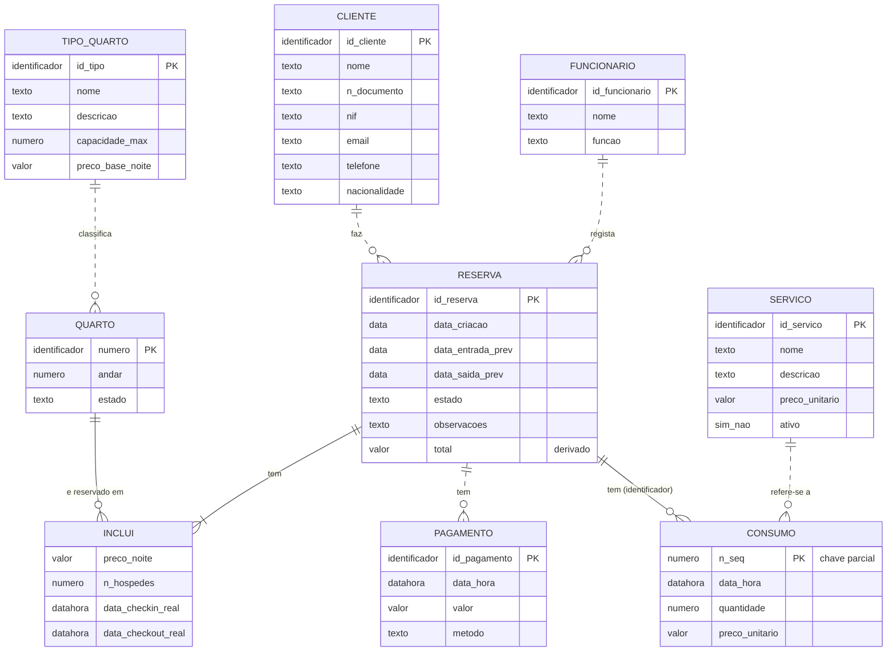

# Modelo conceptual ER (Mermaid)

Versão em Mermaid do modelo conceptual do Contexto A (Alojamento local). A versão principal, em notação de Chen, está em [`modelo_conceptual.drawio`](modelo_conceptual.drawio).

## Como ler

- **Cardinalidades** (pé de galinha): `||` exatamente um, `o{` zero ou mais, `|{` um ou mais.
- **Linha contínua** (`--`): relacionamento identificador. **Linha tracejada** (`..`): não identificador.
- Os "tipos" (`texto`, `data`, `valor`...) são **domínios conceptuais**, não tipos SQL. O Mermaid obriga a indicar um tipo em cada atributo.

## Diferenças em relação à notação de Chen

| Chen (`.drawio`) | Neste Mermaid |
|---|---|
| `INCLUI` é um **relacionamento N:M** com atributos | Aparece como **entidade associativa** `INCLUI`, porque o Mermaid não permite atributos em relacionamentos. Este é o ponto onde o diagrama já se aproxima do modelo relacional. |
| `CONSUMO` é **entidade fraca** | Marcada só pela linha contínua e pelo comentário "chave parcial". Não há símbolo de entidade fraca. |
| Participação total (linha dupla) | Só se vê pela cardinalidade mínima (`||` e `|{` = total; `o{` = parcial). |
| Atributo derivado (elipse tracejada) | Comentário "derivado" no atributo. |
