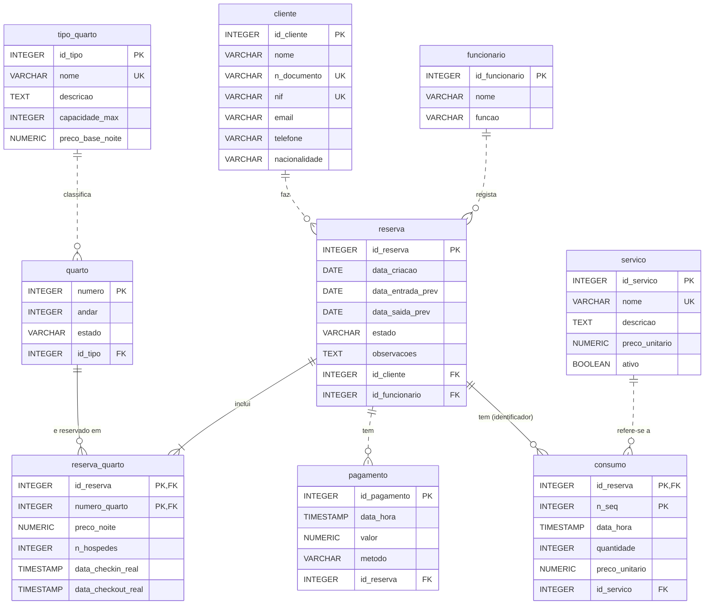

# Modelo relacional (Fase 2)

Resultado do mapeamento do modelo conceptual ([`modelo_conceptual.drawio`](modelo_conceptual.drawio)) para o modelo relacional. Os tipos são os usados na implementação em PostgreSQL.

## Como ler

- **Cardinalidades** (pé de galinha): `||` exatamente um, `o{` zero ou mais, `|{` um ou mais.
- **Linha contínua** (`--`): a chave estrangeira faz parte da chave primária da tabela filha. **Linha tracejada** (`..`): a chave estrangeira é um atributo normal.
- `PK` chave primária, `FK` chave estrangeira, `UK` valor único (o `nif` pode ser `NULL`).

## Alterações em relação ao modelo conceptual

| Conceptual (Fase 1) | Relacional (Fase 2) |
|---|---|
| Relacionamento N:M `INCLUI` com atributos | Tabela `reserva_quarto`, com PK composta `(id_reserva, numero_quarto)` |
| Entidade fraca `CONSUMO` | Tabela `consumo`, com PK composta `(id_reserva, n_seq)` |
| Atributo derivado `total` em `RESERVA` | **Não é guardado** (RN16); calcula-se numa consulta ou vista |
| Relacionamentos 1:N | Chave estrangeira na tabela do lado N |
| Domínios conceptuais (`texto`, `valor`…) | Tipos SQL do PostgreSQL |

## Domínios completos da implementação

As relações e atributos estão no diagrama acima. As chaves candidatas, DF,
normalização e justificações estão em [`docs/fase2.md`](../docs/fase2.md).
Todos os atributos são obrigatórios (`NOT NULL` ou PK/IDENTITY), exceto os
indicados como opcionais abaixo. `TIMESTAMP` significa sem fuso horário:
os dados operacionais são tratados na hora local do alojamento.

| Tabela | Domínios dos atributos | Opcionais e valores por omissão |
|---|---|---|
| `tipo_quarto` | `id_tipo INTEGER IDENTITY`; `nome VARCHAR(50)`; `descricao TEXT`; `capacidade_max INTEGER >= 1`; `preco_base_noite NUMERIC(10,2) > 0` | `descricao` opcional |
| `quarto` | `numero INTEGER > 0`; `andar INTEGER` (permite caves); `estado VARCHAR(20)` em `operacional`, `manutencao`; `id_tipo INTEGER` | `estado` por omissão `operacional` |
| `cliente` | `id_cliente INTEGER IDENTITY`; `nome VARCHAR(100)`; `n_documento VARCHAR(30)`; `nif VARCHAR(20)`; `email VARCHAR(100)`; `telefone VARCHAR(20)`; `nacionalidade VARCHAR(50)` | `nif`, `email`, `telefone`, `nacionalidade` opcionais |
| `funcionario` | `id_funcionario INTEGER IDENTITY`; `nome VARCHAR(100)`; `funcao VARCHAR(50)` | Sem opcionais |
| `reserva` | `id_reserva INTEGER IDENTITY`; `data_criacao`, `data_entrada_prev`, `data_saida_prev DATE`; `estado VARCHAR(20)` em `confirmada`, `em_curso`, `concluida`, `cancelada`; `observacoes TEXT`; `id_cliente`, `id_funcionario INTEGER` | `observacoes` opcional; criação por omissão `CURRENT_DATE`; estado por omissão `confirmada`; saída > entrada |
| `reserva_quarto` | `id_reserva`, `numero_quarto INTEGER`; `preco_noite NUMERIC(10,2) > 0`; `n_hospedes INTEGER >= 1`; `data_checkin_real`, `data_checkout_real TIMESTAMP` | Check-in/out opcionais; checkout preenchido exige checkin e é posterior |
| `servico` | `id_servico INTEGER IDENTITY`; `nome VARCHAR(50)`; `descricao TEXT`; `preco_unitario NUMERIC(10,2) > 0`; `ativo BOOLEAN` | `descricao` opcional; `ativo` por omissão `TRUE` |
| `consumo` | `id_reserva`, `id_servico INTEGER`; `n_seq`, `quantidade INTEGER >= 1`; `data_hora TIMESTAMP`; `preco_unitario NUMERIC(10,2) > 0` | Data/hora por omissão `CURRENT_TIMESTAMP`; sequência parcial explícita |
| `pagamento` | `id_pagamento INTEGER IDENTITY`; `id_reserva INTEGER`; `data_hora TIMESTAMP`; `valor NUMERIC(10,2) > 0`; `metodo VARCHAR(20)` em `numerario`, `cartao`, `transferencia`, `mbway` | Data/hora por omissão `CURRENT_TIMESTAMP` |

`IDENTITY` significa `GENERATED ALWAYS AS IDENTITY`, com PK própria.
O número natural de quarto e os componentes das PK compostas não são gerados.
Os montantes têm duas casas decimais, sem `FLOAT`.

## Restrições e implementação

As nove PK têm nomes `pk_<tabela>`. Há quatro restrições de unicidade:
`uq_tipo_quarto_nome`, `uq_cliente_n_documento`, `uq_cliente_nif` e
`uq_servico_nome`. O NIF anulável não é uma chave candidata clássica.
As oito FK têm nomes explícitos `fk_...` e `ON DELETE RESTRICT`; os destinos
estão indicados pelos relacionamentos e pela documentação de chaves.
Os quinze `CHECK`, com nomes `ck_...`, implementam os domínios positivos,
estados, métodos e a ordem das datas. Os nomes exatos são a referência nos
scripts [`Table.sql`](../sql/Table.sql) e
[`servicos_pagamentos.sql`](../sql/servicos_pagamentos.sql).

A cardinalidade mínima de um quarto por reserva é uma regra do modelo;
a PK/FK da tabela associativa não a garante sozinha. Os restantes limites
da integridade declarativa estão identificados regra a regra em `docs/fase2.md`.
O total, os pagamentos acumulados e o saldo são calculados pela vista
[`v_reserva_total`](../sql/vistas.sql), sem colunas redundantes em `reserva`.
