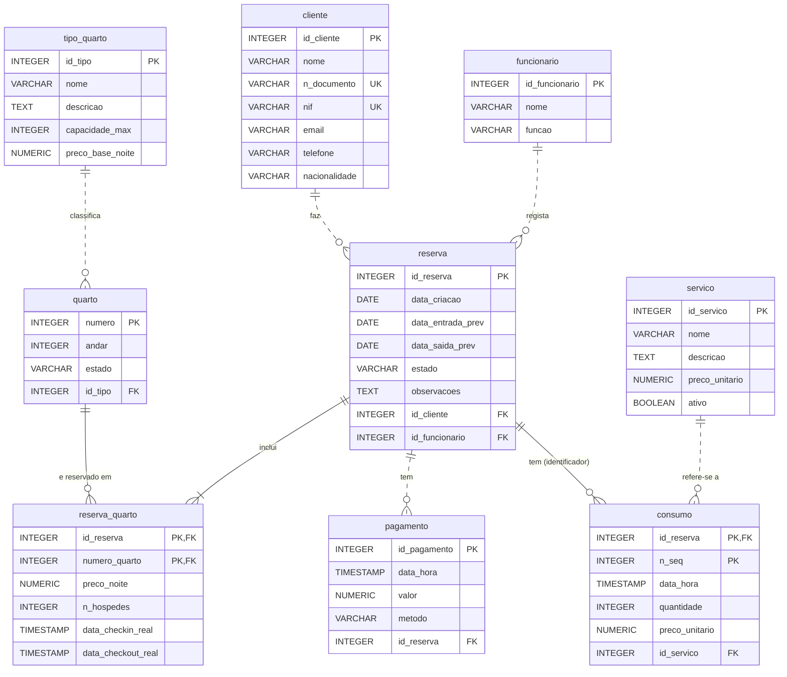

# Modelo relacional (Fase 2)

Resultado do mapeamento do modelo conceptual ([`modelo_conceptual.drawio`](modelo_conceptual.drawio)) para o modelo relacional. Os tipos são os usados na implementação em PostgreSQL.

## Como ler

- **Cardinalidades** (pé de galinha): `||` exatamente um, `o{` zero ou mais, `|{` um ou mais.
- **Linha contínua** (`--`): a chave estrangeira faz parte da chave primária da tabela filha. **Linha tracejada** (`..`): a chave estrangeira é um atributo normal.
- `PK` chave primária, `FK` chave estrangeira, `UK` valor único (o `nif` pode ser `NULL`).

## Alterações em relação ao modelo conceptual

| Conceptual (Fase 1) | Relacional (Fase 2) |
|---|---|
| Relacionamento N:M `INCLUI` com atributos | Tabela `reserva_quarto`, com PK composta `(id_reserva, numero_quarto)` |
| Entidade fraca `CONSUMO` | Tabela `consumo`, com PK composta `(id_reserva, n_seq)` |
| Atributo derivado `total` em `RESERVA` | **Não é guardado** (RN16); calcula-se numa consulta ou vista |
| Relacionamentos 1:N | Chave estrangeira na tabela do lado N |
| Domínios conceptuais (`texto`, `valor`…) | Tipos SQL do PostgreSQL |